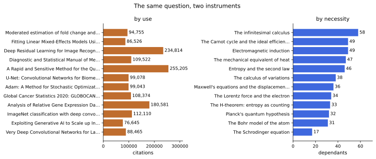

# Usage is not necessity

**Citation counts measure how much a work is *used*. Importance is how much *depends* on it. Those are two opposed quantities, and the citation record cannot tell them apart.**

This repo builds both instruments, measures the gap, and reports what does and does not survive scrutiny.



## The answer

| ranked by **use** (citations) | ranked by **necessity** (transitive reach) |
|---|---|
| limma — moderated fold-change estimation | **The infinitesimal calculus** (58 of 150 downstream) |
| lme4 — mixed-effects models | Electromagnetic induction |
| ResNet | The Carnot cycle |
| DSM — the diagnostic manual | The mechanical equivalent of heat |
| Bradford protein assay | Entropy and the second law |
| Adam optimiser | The calculus of variations |
| GLOBOCAN cancer statistics | Maxwell's equations |
| 2^−ΔΔCt gene expression | The Lorentz force |
| ImageNet | The H-theorem |
| VGG | Planck's quantum hypothesis |
| U-Net | The Bohr model |
| Deep learning for tutoring | The Schrödinger equation |

**Zero overlap.** Not one entry appears in both lists. One column is software, assays, datasets and reporting standards; the other is physics, mathematics and biology. Both are correct answers to different questions.

## Why the gap exists

1. **Citation count is in-degree; importance is transitive in-degree.** A tool cited by 1,000 terminal measurements has reach 1,000. An idea cited by 100 works that each support 100 more has reach 10,100. Rank by in-degree and the tool wins, always.
2. **A citation edge is untyped.** A paper that *uses* BLAST and a paper that *builds on* Shannon produce identical edges. Necessity is a property of the edge's type, and the type is not recorded.
3. **The obvious repair fails.** We tried the PageRank-style fix — rank by how heavy a work's *citers* are. It correlates 0.65 with raw citations, and its top eight are AlexNet, VGG, ResNet, Kohn–Sham, ImageNet, Faster R-CNN, LeNet and SAMtools. Prestige among citers is prestige, and prestige is citations.

## The one thing worth stealing

**Count each criterion's distinct values before letting it rank anything.**

One criterion here took **three** values across 520 works, so its top ranks were tie-breaks. Its rank 1 was the finding that this project had vindicated its own origin — Shannon 1948, the paper it started from. Dropping it moved Shannon out of the top 30 entirely. The check is one line:

```python
if len({row[c] for row in rows}) < 10:
    drop_and_name(c)   # it cannot discriminate; its ranks are the sort function
```

## The strongest result

On the same 150 coded rows, five measures of importance form **two blocks that oppose each other** — what a development *did*, and what *rests on* it. Every between-block correlation is negative:

| | consequence | breadth | peak | necessity |
|---|---|---|---|---|
| **consequence** | 1.00 | 0.74 | 0.71 | **−0.30** |
| **breadth** | 0.74 | 1.00 | 0.16 | **−0.32** |
| **peak** | 0.71 | 0.16 | 1.00 | **−0.15** |
| **necessity** | −0.30 | −0.32 | −0.15 | 1.00 |

The developments that changed the world most are, weakly but consistently, the ones the fewest later developments depend on. A composite "impact score" averaging these is cancelling what it set out to measure.

## What is honest about this

- **The bibliometric layer is real, measured data** — fetched from OpenAlex and committed, so every number reproduces offline.
- **The dependency layer is coded by one person and its reliability is unmeasured.** Every edge is traceable to a source and the graph passes chronology and acyclicity audits, but that is internal consistency, not verification. `scripts/reliability.py` exports a blinded sample for a second coder and reports κ when one exists; until then it says so.
- **Two findings were retracted for reversing under a plausible alternative measurement.** Both concerned classifying works as method or theory: the title classifier and the abstract classifier agree on only 23% of cases, so neither direction is established.

## Reproduce

```bash
pixi install
pixi run gate        # lint, mypy, 36 tests
pixi run all         # edges, bibliography, figures, contrast — no network needed
pixi run docs-build  # the paper
```

Fetches are cached to `data/`, so each runs once: `pixi run fetch-openalex`, `fetch-abstracts`, `fetch-literature`.

## Layout

```
docs/paper.md          the paper
src/world_impact/
  openalex.py          fetch the corpus, the citers, the abstracts
  convergence.py       the instrument: criteria, consensus, the degeneracy and
                       redundancy diagnostics
  linkage.py           transitive reach — the dependency instrument
  fields.py            field flow; net citation exporters
  figures.py           deterministic SVG
data/
  openalex/            the committed corpus, citers, abstracts
  results.yml          150 coded results with effects on 18 outcome domains
  edge-sources.yml     a warrant for each of the 143 prerequisite edges
scripts/               fetch, build, audit
```

Data CC-BY-4.0, code MIT.
