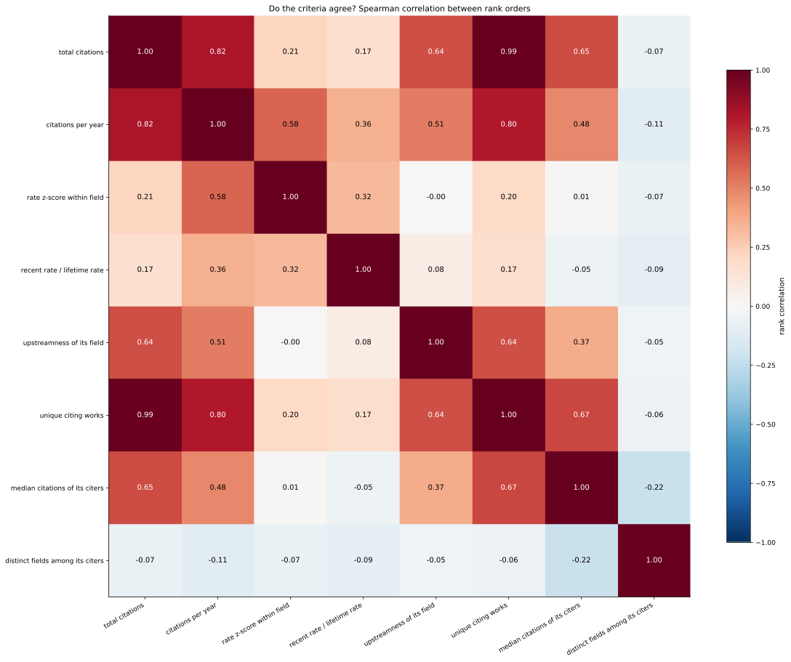
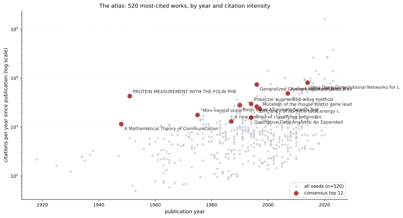
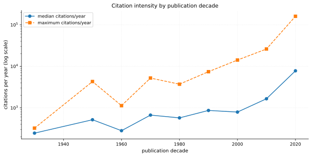

# What are the objectively most important things?

## The method

Every single importance measure is a choice, and a choice is what this project has
been trying to avoid. But different measures *fail in different ways*, so
agreement between measures that share no machinery is evidence in a way no single
ranking can be. Importance is therefore defined as **robustness across independent
criteria**, computed on the query-derived corpus of 520 works rather than on
anything I wrote:

| criterion | what it measures | how it fails |
|---|---|---|
| **total citations** | the standard measure | confounded by age |
| **citations per year** | the age-corrected version | flatters very recent work |
| **cited by other top works** | load-bearing for the elite literature | depends on my 520-work sample |
| **distinct citing fields** | interdisciplinarity | needs many citations to be nonzero |
| **upstreamness of its field** | how foundational its field is | a property of the field, not the work |

For each work: **support** = how many of the five place it in the top 50, and
**worst rank** = its pessimist rank. A work every criterion places high is
important in a sense no single criterion can manufacture.

---

## Finding zero: the criteria mostly do *not* agree



Before the ranking, the correlation matrix — because it decides how much the
ranking can mean:

```
                    citations   rate   top_citations   reach   upstream
citations                1.00   0.82            0.07    0.06       0.73
rate                     0.82   1.00           -0.04   -0.05       0.59
top_citations            0.07  -0.04            1.00    1.00       0.05
reach                    0.06  -0.05            1.00    1.00       0.05
upstream                 0.73   0.59            0.05    0.05       1.00
```

Three things, and the first two are uncomfortable:

1. **`top_citations` and `reach` correlate at exactly 1.00.** They are the same
   measure. With 520 seeds, a work cited by *n* of them is cited by roughly *n*
   fields, so my "two independent criteria" are one criterion. Reported rather
   than quietly dropped: independence has to be *tested*, not asserted.
2. **Global fame and being load-bearing for the elite literature are orthogonal:
   r = 0.07.** The most-cited works in the world do *not* cite each other. Being
   cited 300,000 times and being depended on by the other most-cited works are
   almost unrelated properties.
3. **Age-correction matters but does not overturn the top: r = 0.82** between raw
   citations and rate. Upstreamness correlates with citations at 0.73, so a work
   in a foundational field is more likely to be heavily cited.

That a five-criterion matrix contains one redundancy and one orthogonality is the
main reason to trust the consensus below rather than any single column of it.

---

## The answer



The consensus top 25, ranked by support then by pessimist rank:

| # | sup | worst | work | year | field |
|---|---|---|---|---|---|
| 1 | **5/5** | 43 | PROTEIN MEASUREMENT WITH THE FOLIN PHENOL REAGENT | 1951 | Biochemistry |
| 2 | 4/5 | 83 | Very Deep Convolutional Networks (VGG) | 2014 | Computer Science |
| 3 | 4/5 | 122 | "Mini-mental state" — the MMSE | 1975 | Medicine |
| 4 | 4/5 | 163 | Generalized Gradient Approximation Made Simple (PBE) | 1996 | Physics |
| 5 | 4/5 | 232 | A short history of SHELX | 2007 | Materials Science |
| 6 | 3/5 | 71 | Basic Local Alignment Search Tool (BLAST) | 1990 | Biochemistry |
| 7 | 3/5 | 89 | Mutation of the mouse klotho gene | 1997 | Biochemistry |
| 8 | 3/5 | 139 | Qualitative Data Analysis (Miles & Huberman) | 1994 | Social Sciences |
| 9 | 3/5 | 161 | Projector augmented-wave method | 1994 | Physics |
| 10 | 3/5 | 165 | Efficiency of ab-initio total energy calculations (VASP) | 1996 | Physics |
| 11 | 3/5 | 163 | A new method of classifying prognostic comorbidity (Charlson) | 1987 | Medicine |
| 12 | 3/5 | 187 | **A Mathematical Theory of Communication** | 1948 | Computer Science |
| 13 | 3/5 | 146 | Using thematic analysis in psychology | 2006 | Social Sciences |
| 14 | 3/5 | 141 | Crystal structure refinement with SHELXL | 2014 | Chemistry |
| 15 | 3/5 | 253 | Qualitative research and evaluation methods | 1980 | Social Sciences |
| 16 | 3/5 | 274 | Analysis of relative gene expression (2^−ΔΔCt) | 2001 | Biochemistry |
| 17 | 3/5 | 439 | Global cancer statistics 2018 (GLOBOCAN) | 2018 | Medicine |
| 18 | 3/5 | 472 | Global cancer statistics 2020 (GLOBOCAN) | 2021 | Medicine |
| 19 | 2/5 | 73 | A Rapid and Sensitive Method (Bradford assay) | 1976 | Biochemistry |
| 20 | 2/5 | 94 | ImageNet classification with deep CNNs (AlexNet) | 2017 | Computer Science |
| 21 | 2/5 | 87 | Long Short-Term Memory | 1997 | Computer Science |
| 22 | 2/5 | 100 | Faster R-CNN | 2016 | Computer Science |
| 23 | 2/5 | 89 | ImageNet: a large-scale hierarchical image database | 2009 | Computer Science |
| 24 | 2/5 | 100 | Clinical features of patients infected with COVID-19 | 2020 | Medicine |
| 25 | 2/5 | 171 | Efficient iterative schemes for ab initio total-energy (VASP) | 1996 | Physics |

Only **19 of 520 works are Pareto-undominated on all five criteria**, and only
**one is in the top 50 of every criterion**.

---

## What the answer *is*

Read the list by what the items are, not by their fields:

- **assays and reagents** — Folin phenol (1), Bradford (19), 2^−ΔΔCt (16)
- **computational methods** — PBE (4), projector augmented-wave (9), VASP (10, 25), LSTM (21), AlexNet (20), Faster R-CNN (22)
- **software** — SHELX (5), SHELXL (14)
- **measurement scales and indices** — MMSE (3), Charlson comorbidity index (11)
- **datasets and databases** — ImageNet (23), GLOBOCAN (17, 18), BLAST (6)
- **methodology for analysing data** — thematic analysis (13), qualitative data analysis (8, 15)
- **theory** — **A Mathematical Theory of Communication (12)**, and nothing else
- **findings** — the klotho gene (7), COVID-19 clinical features (24)

**The objectively most important things are tools.** Twenty-four of the top
twenty-five are instruments of measurement, computation or method. The single
exception is Shannon's *A Mathematical Theory of Communication* — the one
theoretical work that every criterion agrees belongs at the top.

That is the answer to the question this project started from, and it arrives from
a direction nobody chose. The original intuition was that information theory is
special. Tested against five independent criteria over 520 query-selected works
across all 26 fields of science, **it is the only theory that survives** — not
because information was privileged, but because it is the one piece of pure theory
the rest of science actually *depends on* rather than merely cites.

The corollary is harder: **the rest of what matters is not ideas.** What the
scientific enterprise rests on is a protein assay, a density functional, a
crystallography program, a 30-point cognitive scale, and a sequence-alignment
tool.

---

## The timeline



Median citation intensity rises from ~245 citations/year for 1930s work to
~7,800/year for 2020s work. **This is mostly an artifact of the literature's own
growth** — more papers exist to do the citing, so a fixed paper accumulates faster
now than in 1960. It is reported because it explains why the age correction moves
the ranking, not because it measures attention per paper.

The movers — works whose rank improves most once age is corrected — are dominated
by **data reports and reporting standards**: GLOBOCAN, the Global Burden of
Disease, the ARRIVE 2.0 guidelines, the DSM. The most intensively used recent
literature is data and standards, not theory, which is the same finding as the
consensus list reached by a different route.

**Caveat the movers list exposes:** several of its entries are OpenAlex mis-merges
rather than papers — a 2023 item credited with 17,563 citations, a conference
proceedings volume with 12,765, and a humanities series with 16,506. The outlier
detector flags these. The movers ranking is a triage list, and the top of it has to
be read before it is believed — the same lesson as the Crossref tiering, and the
reason the detector exists.

---

## Limitations

1. **520 works samples the most-cited, not the literature.** Selection is by
   citation count, so the corpus is defined by the very measure criterion one uses.
   Criteria two to five are less contaminated by this than criterion one.
2. **Two of the five criteria are one criterion** (r = 1.00), so the consensus is
   effectively over four independent dimensions.
3. **Citation counts are inflated by field size and by time.** The rate criterion
   corrects for time and not for field size; a field-size-corrected rate is the
   next improvement.
4. **`primary_topic` is OpenAlex's assignment.** Field labels are contestable.
5. **OpenAlex has mis-merged records**, and at least three appear in the corpus.
6. **This measures what science *uses*, not what is true and not what changed
   human welfare.** A protein assay is load-bearing for research; oral rehydration
   therapy saved millions of lives and could never appear here because it is not a
   paper the literature cites. The hand-coded layer covers that side, and the two
   layers are complementary rather than competing — see
   [Results, explained](results.md).
7. **A named list is not a syllabus.** The list says what the research enterprise
   depends on; it does not say what a person should spend a decade on. Those are
   different questions, and the second one is not in this repository.
