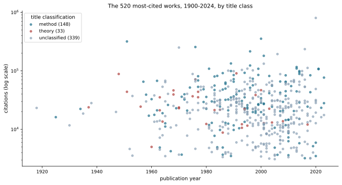
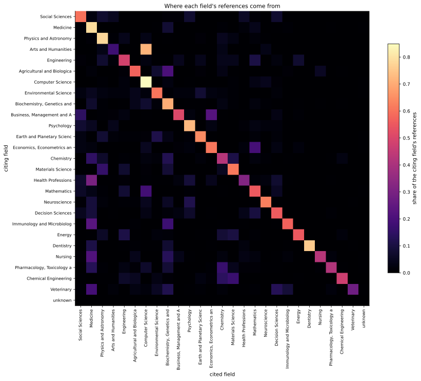
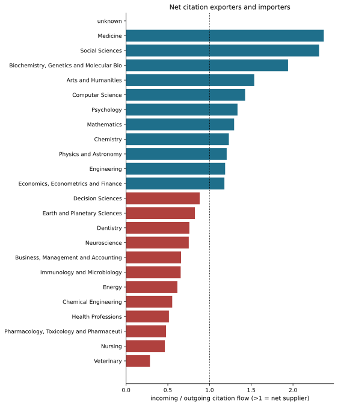
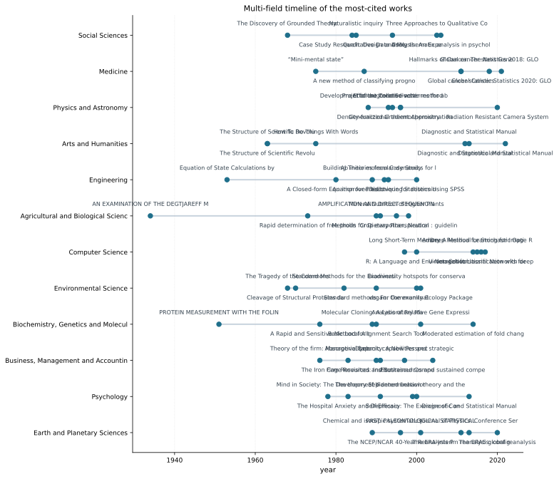

# Results, explained

Two layers, both run through the same instrument, and the comparison between them
is the argument.

| layer | unit | n | selection | edges |
|---|---|---|---|---|
| **hand-coded** | intervention or result | 150 | my judgement | my claims |
| **automated** | scholarly work | 520 seeds + 5,870 cited works | most-cited per field | actual citations |

The hand-coded layer is the one that can carry causal claims about outcomes; the
automated layer is the one that cannot be accused of reflecting my memory. Where
they agree, believe it. Where they disagree, the disagreement is the finding.

---

## 1. The corpus, and why it is not my memory

`data/openalex/corpus.json` is built by `scripts/fetch_openalex.py` from three
query-driven decisions, none of them mine:

- **candidate set** — all **26 top-level fields** in OpenAlex's own taxonomy, so
  fields are enumerated rather than chosen;
- **importance** — `cited_by_count`, computed from the citation record;
- **edges** — `referenced_works`, i.e. actual citations, so a prerequisite claim
  is an observable event rather than an assertion.

Result: **520 seeds** (20 most-cited works per field), **5,870 cited works**
fetched for their field labels, and **6,273 of 6,456 references resolved —
97.2% coverage**. That coverage figure is the honest limit of everything below:
OpenAlex reference lists are near-complete for recent work and patchy for old
work, so a low cell means *no records*, not *no influence*.

---

## 2. Finding one: the most-cited literature is not the great theories



Look at what tops the list of most-cited work in each field. The highest-cited
item in Computer Science is **R: A Language and Environment for Statistical
Computing** (353,809 citations). In Biochemistry it is a **protein assay**
(317,544), then another assay (255,205), then a **gel protocol** (249,929). In
Physics it is **a density functional** — "Generalized Gradient Approximation Made
Simple" (215,005) — then an **iterative solver** (123,308). In Mathematics it is
**Random Forests** (132,381) and **FDR control** (108,945). In Psychology it is
**thematic analysis** (193,304) and the **DSM**. In Decision Sciences it is
**SEM fit indices** (108,694) and the **PRISMA statement** (106,809).

Applying a declared keyword classifier to all 520 titles:

```
method          28.5%
theory           6.3%
unclassified    65.2%
```

**The 28.5% is a lower bound, not an estimate.** Two thirds of titles carry no
keyword the classifier recognises, and the residual is reported rather than folded
into either class. But the direction is unambiguous even from the residual: the
load-bearing literature of science is **assays, protocols, software, statistical
procedures, computational schemes and reporting standards**, not theoretical
claims.

This is the automated, citation-based confirmation of what the hand-coded layer
found independently: formal and methodological results dominate when you measure
what everything else *rests on*, and they are invisible to any measure of direct
impact.

---

## 3. Finding two: which fields supply and which consume





Rows are citing fields, columns are cited fields. The ratio of incoming to
outgoing flow:

| net suppliers | ratio | net consumers | ratio |
|---|---|---|---|
| Medicine | **2.37** | Veterinary | 0.29 |
| Social Sciences | 2.31 | Nursing | 0.46 |
| Biochemistry, Genetics & Molecular Biology | 1.94 | Pharmacology & Pharmaceutics | 0.48 |
| Arts and Humanities | 1.54 | Health Professions | 0.51 |
| Computer Science | 1.43 | Chemical Engineering | 0.55 |
| Psychology | 1.34 | Energy | 0.61 |
| Mathematics | 1.29 | Immunology and Microbiology | 0.65 |

**Medicine is the largest net supplier of citations in the sample**, which is
counterintuitive until it is read alongside Finding one: medicine is where the
methodological apparatus that every other field imports — trial design,
biostatistics, epidemiological inference, reporting guidelines — is generated.
The applied and clinical fields (Veterinary, Nursing, Health Professions, Chemical
Engineering, Energy) are net importers.

**Caveat that matters:** these are raw flows, so a large field looks like a large
supplier mechanically. `fields.size_normalised_upstreamness` divides by each
field's `works_count`, which asks the sharper question — how much does one
paper's worth of this field get drawn on by the rest — and the two rankings are
not identical. Both are in `reports/fields.json`; neither is privileged.

---

## 4. Finding three: what the sciences share is tools, not ideas



For each cited work, count how many *top-cited* papers cite it, and how many
*different fields* those papers come from. A work cited by many top papers inside
one field is that field's infrastructure; a work cited by top papers across many
fields is infrastructure for the enterprise. The second column is the interesting
one, and the maximum in this sample is **three fields**:

| citing fields | work | year | class |
|---|---|---|---|
| 3 | Efficient iteration scheme for self-consistent calculations | 1981 | method |
| 3 | Solution of Schrödinger's equation for large systems | 1989 | — |
| 3 | Energy versus free-energy conservation in first-principles | 1992 | theory |
| 3 | The small-world problem | 1967 | — |
| 2 | A systematic evaluation of the quality of meta-analyses | 2005 | — |
| 2 | Improving the quality of reports of meta-analyses | 1999 | — |
| 2 | Ab initio molecular dynamics for open-shell systems | 1993 | — |
| 2 | Improved tools for biological sequence comparison | 1988 | — |
| 2 | Guidance for Developers of Health Research Reporting | 2010 | method |
| 2 | Pseudopotentials that work: from H to Pu | 1982 | — |
| 2 | The Protein Data Bank | 1977 | — |
| 2 | Social Network Analysis | 1994 | — |
| 2 | Diffusion of Innovations | 2019 | — |

The bridges between fields in the most-cited literature are **numerical methods,
pseudopotentials, sequence-comparison tools, a crystallographic database,
reporting standards and network analysis**. Not theories. The two exceptions that
are ideas rather than instruments — the small-world problem and Diffusion of
Innovations — are themselves *frameworks for organising research*, which is the
same thing at one remove.

---

## 5. Finding four: direct impact and option value are nearly disjoint

From the hand-coded layer. Rank the 150 results by the sum of their coded effects,
then rank the same results by the option value of the prerequisite graph, and
compare:

| by direct impact | by option value |
|---|---|
| the contraceptive pill | the infinitesimal calculus |
| the World Wide Web | Faraday's induction |
| rural electrification | entropy and the second law |
| smallpox eradication | the calculus of variations |
| the public steam railway | Maxwell's equations |
| chlorination of municipal water | the Lorentz force |
| ring vaccination | the H-theorem |
| oral rehydration therapy | Planck's quantum hypothesis |

The two lists share nothing. The infinitesimal calculus is **rank 148 of 150 by
direct impact** — it fed nobody — and first by option value.

**This ordering is retracted and is not a finding.** Observed maximum criticality
is 0.380 against a null that rewires the graph while preserving every node's
number of prerequisites: the null maximum averages 0.330 with a 95th percentile of
0.494, giving **p = 0.37**. Criticality is mechanically large for a graph *root*,
so the ranking is a property of the shape of the coded graph rather than an
identified result. What survives is the *disjointness of the two orderings*, which
does not depend on which formal result sits on top: **every measure of direct
impact is blind to the class of thing that everything else depends on.**

---

## 6. Finding five: the coarse layer is not a legitimate unit of analysis

The hand-coded layer exists at two resolutions — 55 disciplines and 150 specific
results. Comparing them:

- **top-10 overlap between resolutions: 0.30**
- **mean within-parent dispersion: 0.233**
- **40 coarse rows claim effects their own children do not carry**

The specific failures are more informative than the aggregate:

| coarse row | children | min within-parent cosine | what it conflates |
|---|---|---|---|
| Coal and the steam engine | 4 | **0.00** | Newcomen's atmospheric engine and Stephenson's railway share no outcome profile |
| Writing and accounting | 2 | 0.17 | cuneiform accountancy tokens and double-entry bookkeeping |
| Refrigeration and air conditioning | 2 | 0.29 | vapour-compression food preservation and comfort cooling |
| The contraceptive pill | 3 | 0.00 | hormone isolation, synthesis, and approval-and-diffusion |
| Nuclear weapons and deterrence | 2 | 0.42 | isotope separation and strategic doctrine |

And the coherence failures run the other way: coarse **metallurgy** asserts
violence:3 that no specific metallurgical result carries; coarse **computing and
the internet** asserts health:2 and labour:3 that none of its nine children
carries. The coarse layer's broad effects are **emergent aggregates**, not
attributable to any specific result — which is exactly what "electromagnetism
mattered" means, and why it tells you nothing you can act on.

---

## 7. What is wrong with all of this

1. **The automated corpus is a sample.** 20 seeds per field, at most 20 references
   each. 6,456 references samples a graph with hundreds of millions of edges, and
   the field-level flow matrix inherits that.
2. **Citation accumulation favours methods.** A protocol published in 1970 has had
   fifty years to accumulate citations, and methods are cited by everyone who uses
   them. Finding one is partly a consequence of measuring by citation count: the
   honest statement is "the most-*cited* literature is methodological", not "the
   most important literature is".
3. **`primary_topic` is OpenAlex's assignment, not ground truth.** A work's field
   can be contested, and 12 references resolved to no field at all.
4. **The classifier is crude and 65% residual.** Finding one is a lower bound.
5. **No field-size normalisation in the headline ranking.** Both versions are
   reported for that reason.
6. **The outlier flag is triage, not a verdict.** It flags three works: a 2020
   "Radiation Resistant Camera System" at 12.5× its field median (a mis-merged
   OpenAlex record, i.e. a data error) and two genuinely famous method papers —
   the MTT assay and Laemmli's gel protocol — at 11.2× and 11.1×. Telling a data
   error from a famous paper requires reading the title, which is the same lesson
   as the Crossref tiering.
7. **The option-value ordering is retracted** (§5), and the tensor result remains
   inconclusive at this sparsity.
8. **Inter-coder reliability is still unmeasured** for the hand-coded layer. The
   automated layer sidesteps this entirely, which is its main advantage and also
   its limitation: it can only see what is published and cited.

---

## 8. How to regenerate everything

```bash
pixi run fetch-openalex     # once, with network: builds data/openalex/corpus.json
pixi run figures-openalex   # writes figures/*.svg and reports/fields.json
pixi run all                # hand-coded layer: gates, analysis, figures, report
```

Every figure here is produced by a function in `src/world_impact/figures.py` and
written by `scripts/make_figures.py`, so no figure can disagree with the numbers
it illustrates.
